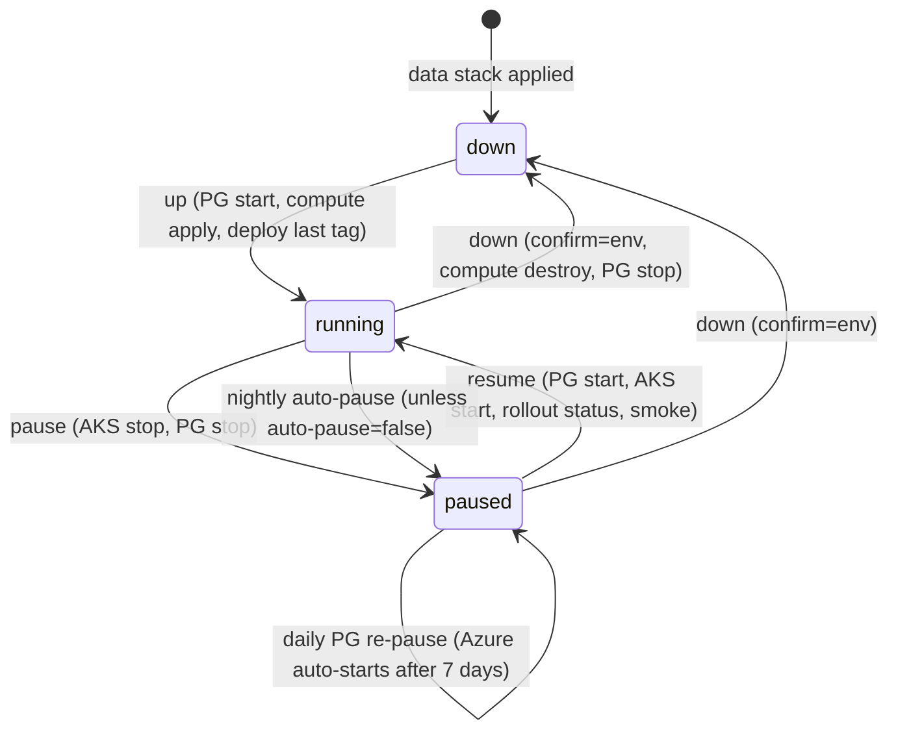

# ADR 0001: Azure environment topology

- **Status:** Accepted
- **Date:** 2026-10-19
- **Scope:** `infra/terraform/**`, `deploy/helm/bbm/**`, `.github/workflows/**`

## Context

The DevOps goal for this project is to "plan and architect the marketplace system and execution
environment, designing for horizontal scalability and ensuring stability under sustained load;
integrate external tools and protocols and coordinate integration across system components; and
implement DevOps tooling to support fast development iteration."

Constraints:

- The Azure subscription is brand new. Nothing is deployed, quotas are at their defaults and some
  resource providers aren't registered.
- This is a student project on a small budget (budget alerts at $50/month). Prod and staging exist
  for demos and testing, so both must be **switchable on and off on demand**.
- Every pull request should get fast feedback from real containers. Pipeline test runs and PR
  previews need a short-lived cloud environment that is always torn down.
- Several agents and people implement Terraform, Helm and workflows in parallel worktrees. The
  interfaces between those pieces have to be pinned up front (see [Pinned interfaces](#pinned-interfaces)).
- The analysis worker and the PoC sandbox run untrusted input (uploaded Solidity, auditor-submitted
  Foundry tests), so the platform needs a path to strong isolation.

Region is `eastus2` (abbreviation `eus2`), with `centralus` as the fallback if a SKU is restricted
for the new subscription. Project prefix is `bbm`.

## Decision

### 1. Two kinds of environment

| Environment            | Platform                                    | Lifetime                                    | Data                           |
| ---------------------- | ------------------------------------------- | ------------------------------------------- | ------------------------------ |
| `test` (pipeline test) | Azure Container Apps, stack `aca-ephemeral` | one workflow run, destroyed with `always()` | Postgres sidecar, thrown away  |
| `preview` (per PR)     | Azure Container Apps, stack `aca-ephemeral` | PR open → PR close (TTL 168 h)              | Postgres sidecar, thrown away  |
| `staging`              | own AKS cluster, stacks `data` + `compute`  | long-lived, on demand                       | PG Flexible Server, persistent |
| `prod`                 | own AKS cluster, stacks `data` + `compute`  | long-lived, on demand                       | PG Flexible Server, persistent |

- **Ephemeral envs on ACA.** A Consumption ACA environment (no VNet) in `rg-bbm-test-eus2` or
  `rg-bbm-preview-eus2` comes up in a couple of minutes and costs nothing when idle. The `api` app
  runs Postgres (`<acr>/mirror/postgres:16-alpine`) as a sidecar on `localhost:5432`, with
  min = max = 1 replica. Data dies with the environment, which is fine for tests and previews.
  Resources are tagged `ephemeral=true` and `expires_on=<RFC3339>`. `infra-janitor.yml` sweeps
  anything past its expiry.
- **Staging and prod on AKS, one cluster each.** These are the environments where horizontal
  scaling, ingress, workload identity, network policy and sandboxing are exercised for real. A
  separate cluster per env keeps the blast radius small and makes power control per env trivial.

### 2. Data / compute split and on-demand power

Each AKS environment is two Terraform stacks with separate state:

- **`data`** (persistent, `rg-bbm-<env>-data-eus2`): VNet, PG Flexible Server, Key Vault, storage
  account (blob container `sources`, queue `analysis-jobs`), user-assigned identities, the static
  ingress public IP and the env Log Analytics workspace.
- **`compute`** (disposable, `rg-bbm-<env>-compute-eus2`, node RG `rg-bbm-<env>-aksnodes-eus2`): the
  AKS cluster, its node pools and the workload-identity federated credentials.

Because nothing durable lives in `compute`, it can be destroyed and recreated without losing data,
the IP or the DNS name. That gives two levels of "off":

- **pause / resume:** `az aks stop|start` plus `az postgres flexible-server stop|start`. Fast, keeps
  every resource, stops node and PG compute billing.
- **down / up:** `terraform destroy` / `apply` of the **compute stack only**, plus PG stop/start.
  Near-zero cost, slower to return.

The live state is stored as tags on the data RG, so workflows can read it without a database:
`power-state=running|paused|down`, `bbm-last-deployed-tag=<tag>`, `auto-pause=true|false`. Terraform
sets `ignore_changes` on those tag keys.



`env-power.yml` drives this (actions `status`, `pause`, `resume`, `down`, `up`; inputs `env`,
`action`, `include_db`, `confirm`). Its logic lives in `infra/terraform/scripts/env-power.sh`. It
shares the concurrency group `env-<env>` with `deploy.yml`, so a deploy and a power change never race.
`deploy.yml` skips cleanly if the cluster isn't running.

### 3. Terraform layout: shared stacks plus per-env tfvars

One copy of each stack (`stacks/{bootstrap,global,data,compute,aca-ephemeral}`), parameterised by
`envs/<env>/*.tfvars` and a backend config. `scripts/tf.sh <stack> <env> <action>` is the single entry
point. Ephemeral envs pass their state key at init (`test/run-<run_id>-<attempt>.tfstate`,
`preview/pr-<n>.tfstate`), so any number can exist at once.

State lives in `rg-bbm-tfstate-eus2` / `stbbmtfstate<sfx>` / container `tfstate`, accessed with Entra
ID auth only (no account keys). Cross-stack reads use `terraform_remote_state`: compute reads data,
and data, compute and aca-ephemeral read global.

### 4. GitHub to Azure over OIDC

No client secrets anywhere. Each GitHub Environment maps to an app registration with a federated
credential for `repo:LoistCloist/bug-bounty-marketplace:environment:<env>`:

| GitHub Environment  | Protection                                      | App registration    |
| ------------------- | ----------------------------------------------- | ------------------- |
| `test`              | none                                            | `gh-bbm-ephemeral`  |
| `preview`           | none                                            | `gh-bbm-ephemeral`  |
| `infra-global`      | 1 required reviewer, `main` only                | `gh-bbm-global`     |
| `staging`           | `main` only                                     | `gh-bbm-staging`    |
| `prod`              | 1 required reviewer, `main` only                | `gh-bbm-prod`       |
| `prod-power`        | no reviewer, `main` only (scheduled auto-pause) | `gh-bbm-prod-power` |
| `contracts-sepolia` | 1 required reviewer                             | `gh-bbm-global`     |

A separate read-only `gh-bbm-plan` identity (subjects `pull_request` and `ref:refs/heads/main`) runs
`terraform plan` on PRs. It has subscription Reader and a path-conditioned Storage Blob Data Reader on
state (`global.tfstate`, `staging/`, `test/`, `preview/`; never `prod/` or `bootstrap.tfstate`), so
plan jobs run with `-lock=false`. It has no Key Vault data-plane role. Prod plans run in the `prod`
environment as `gh-bbm-prod`.

Least privilege per identity:

- `gh-bbm-ephemeral`: Contributor on the test and preview RGs, Reader on the shared RG, AcrPush, Managed
  Identity Operator on `id-bbm-aca-pull` and Log Analytics Contributor on the shared LAW.
- `gh-bbm-global`: Contributor on the shared RG, a constrained RBAC Administrator on the shared RG
  (AcrPull, AcrPush, Managed Identity Operator, Log Analytics Contributor, Key Vault Secrets
  Officer/User), Key Vault Secrets Officer on the shared RG (contracts-sepolia reads the Sepolia
  secrets) and Cost Management Contributor on the subscription.
- `gh-bbm-staging` and `gh-bbm-prod`: Contributor on their env's data and compute RGs, a constrained
  RBAC Administrator on both, AKS RBAC Cluster Admin on compute, Key Vault Secrets Officer on data,
  Reader on the shared RG plus a constrained RBAC Administrator there that may only grant AcrPull.
- `gh-bbm-prod-power`: only `BBM Power Operator` on the prod data and compute RGs. No Contributor, no
  RBAC admin and no state access, so the reviewer-free `prod-power` environment can pause and resume
  prod but cannot change it. (Staging's scheduled pause uses `gh-bbm-staging`, which has no reviewer
  gate anyway.)
- The custom role `BBM Power Operator` covers managedClusters read/start/stop, flexibleServers
  read/start/stop and tag writes.
- **Constrained RBAC Administrator** conditions allow role assignment writes only for an allow-listed
  set of role definition GUIDs **and** `PrincipalType == ServicePrincipal`, and deletes only for the
  same role definitions. CI can therefore only grant roles to workload/managed identities, never to a
  user or group. Granting a human or group (e.g. adding an admin to `secret_officer_object_ids`) is
  applied locally by an Owner.
- **State access is prefix-scoped with ABAC** on the blob path (which excludes the container name):

  | Identity           | Role on `tfstate`             | Read + write        | Read only                                         |
  | ------------------ | ----------------------------- | ------------------- | ------------------------------------------------- |
  | `gh-bbm-ephemeral` | Storage Blob Data Contributor | `test/`, `preview/` | `global.tfstate`                                  |
  | `gh-bbm-global`    | Storage Blob Data Contributor | `global.tfstate`    | none                                              |
  | `gh-bbm-staging`   | Storage Blob Data Contributor | `staging/`          | `global.tfstate`                                  |
  | `gh-bbm-prod`      | Storage Blob Data Contributor | `prod/`             | `global.tfstate`                                  |
  | `gh-bbm-plan`      | Storage Blob Data Reader      | none                | `global.tfstate`, `staging/`, `test/`, `preview/` |

  Read conditions cover `blobs/read` except the `Blob.List` suboperation; write conditions cover
  `blobs/write`, `blobs/add/action`, `blobs/delete` and `blobs/move/action`. List Blobs has no blob
  path attribute, so listing key names stays unconditional (contents never are). The backend's state
  lock is a blob lease, which is `blobs/write` on the key's own blob, so locking works wherever writes
  are allowed. `bootstrap.tfstate` is human-only (the bootstrap applier and `admin_object_ids`).

Repo variables (not secrets): `AZURE_TENANT_ID`, `AZURE_SUBSCRIPTION_ID`, `AZURE_PLAN_CLIENT_ID`,
`TFSTATE_RG`, `TFSTATE_ACCOUNT`, `ACR_NAME`, plus a per-environment `AZURE_CLIENT_ID`. Every Azure
workflow's first job gates on `vars.AZURE_CLIENT_ID != ''` (and on the PR not being from a fork), so
the workflows skip green until bootstrap has run.

### 5. `ci.yml` stays Azure-free

`ci.yml` builds and tests real containers (images job, compose-based `system` job, `terraform-static`,
`helm`) but never logs in to Azure. The required `CI OK` check therefore never depends on cloud
credentials, quota or uptime. Azure work lives in separate workflows:

| Workflow                | Purpose                                                                                         |
| ----------------------- | ----------------------------------------------------------------------------------------------- |
| `_build-push.yml`       | reusable: build and push images to ACR with SBOM/provenance                                     |
| `integration-azure.yml` | apply `aca-ephemeral` (`kind=test`), run smoke/integration/e2e (+ k6 on demand), always destroy |
| `preview.yml`           | per-PR `aca-ephemeral` (`kind=preview`, mocked web), sticky comment, destroy on close           |
| `terraform.yml`         | plan on PR (sticky comment), global auto-apply on `main`, dispatch plan/apply per stack         |
| `deploy.yml`            | Helm deploy to staging/prod (power gate, image check, `/health` smoke)                          |
| `env-power.yml`         | on-demand power: `status`, `pause`, `resume`, `down`, `up`, plus schedules                      |
| `contracts-deploy.yml`  | dispatch-only Sepolia deploy via `Deploy.s.sol`, dry run by default                             |
| `infra-janitor.yml`     | every 6 h: sweep expired ephemeral resources and orphaned state, ACR purge                      |

### 6. Cluster platform

- **AKS** Free tier, OIDC issuer and workload identity enabled, Entra ID RBAC with local accounts off,
  Azure CNI Overlay with Cilium network policy. Default VM size `Standard_B2als_v2`.
- **Ingress:** the app-routing add-on (managed NGINX). A `NginxIngressController` named `bbm` gives
  the ingress class `bbm-nginx`, bound to the static public IP `pip-bbm-<env>-ingress`. That IP lives
  in the **data** RG so it survives `down`/`up`, and its DNS label gives the stable host
  `bbm-<env>.eastus2.cloudapp.azure.com`.
- **Secrets:** the Key Vault Secrets Store CSI add-on with workload identity. SecretProviderClass
  `bbm-kv` syncs Key Vault secrets into the K8s Secret `bbm-secrets`. Pods authenticate as
  user-assigned identities (`id-bbm-<env>-{api,worker,sandbox}`) through federated service accounts.
- **Queue:** Azure Storage Queue `analysis-jobs` for now. It is cheap, needs no extra namespace and
  KEDA has a scaler for it. Service Bus is the upgrade path once dead-lettering, sessions or topics
  are needed.
- **Autoscaling the analysis worker:** the KEDA add-on, with a ScaledObject on queue length for
  `bbm-analysis` (disabled until the worker does real work).

### 7. Horizontal scalability and stability under load

- **Node level:** cluster autoscaler on every pool. `system` 1–2 nodes; `apps` 0–3 (min 1 in prod,
  0 in staging); `sandbox` 0–1.
- **Pod level:** HPA on `web` and `api` (CPU). A PodDisruptionBudget only when min replicas > 1, so
  a single-replica env can still drain. Topology spread constraints across nodes and zones.
- **Database connections:** PG `B_Standard_B1ms` allows roughly 50 connections. Each API pod uses
  `PG_POOL_MAX=5`, which leaves headroom for migrations, the worker and admin sessions as replicas
  grow.
- **Migrations:** run once per release as a Helm pre-install/pre-upgrade Job
  (`node dist/migrate-cli.js`, SA `bbm-migrations`) with `MIGRATE_ON_BOOT=false` in the
  Deployment, so replicas don't race on schema changes.
- **Known cap: API is limited to 1 replica.** Uploaded sources are written to local disk
  (`SOURCE_STORAGE_DIR`). Until a Blob storage adapter replaces that (the `sources` container and the
  `storageBlobEndpoint` value already exist for it), more than one API replica would split uploads
  across pods. `web` scales freely.
- **Load testing:** the k6 baseline (`tests/load/api-baseline.js`, p95 < 500 ms, errors < 1%) runs
  against the pipeline-test env when `integration-azure.yml` is dispatched with `load`.

### 8. Sandbox for untrusted PoC execution

A dedicated `sandbox` node pool runs auditor PoCs in VM-isolated pods with Kata containers (AKS pod
sandboxing on an Azure Linux node pool, selected through the pool's workload runtime and a Kata
`runtimeClassName`). It is in its own namespace `bbm-sandbox`,
with a deny-all NetworkPolicy, a ResourceQuota and SA `bbm-sandbox-runner`. Both the pool and the
Helm Job template are **disabled by default**. Kata needs a nested-virtualisation VM size (Dsv5
family), which costs more and needs quota a new subscription may not have.

### 9. Images

- ACR `acrbbm<sfx>` (Basic, admin user off) with repositories `bbm/api`, `bbm/web`, `bbm/analysis`
  and `bbm/contracts`.
- Tags are `sha-<7>` on `main`/releases and `pr-<n>-sha-<7>` for previews. The mocked web build
  (`NEXT_PUBLIC_API_MOCKING=enabled`) adds the suffix `-mocked`. Previews use it because the real API
  only serves `/api/contracts*` today.
- Third-party images used at runtime are mirrored into ACR (e.g. `mirror/postgres:16-alpine`) to
  avoid Docker Hub rate limits.
- Ports: web 3000 (`/healthz`), api 3001 (`/health`), analysis 8000 (`/health`), anvil 8545.

## Alternatives considered

- **One shared non-prod AKS cluster with a namespace per env (test, preview, staging).** It's cheaper
  per env when everything is on, but the cluster can't be switched off without taking all non-prod
  envs down. Namespaces also give weaker isolation for untrusted PoC runs. Test runs would compete for
  nodes with staging. Rejected.
- **A cluster per env, including the test env.** It's the most production-like, but creating a
  cluster takes 5–10 minutes per run and 3+ vCPUs each, which a new subscription's quota can't sustain
  for concurrent PRs. Rejected.
- **ACA everywhere except prod.** This is simpler, but then staging would no longer rehearse the prod
  deploy path (Helm, ingress, workload identity, network policy, KEDA), and prod would be the first
  place it runs. Rejected.
- **PG Flexible Server for ephemeral envs.** It's realistic, but provisioning takes 5–15 minutes, it
  bills by the hour with a minimum, and it needs a VNet for private access. A sidecar is enough for
  tests whose data is thrown away. Rejected.
- **Self-managed ingress-nginx via Helm.** It's more configurable, but it's one more component to
  upgrade and patch, and the community ingress-nginx project is in maintenance mode. The app-routing
  add-on is managed and supports a static IP from another RG. Rejected.
- **Kustomize instead of Helm.** It's fine for overlays, but Helm gives hooks (the migration Job,
  ordered SA/SPC creation), `helm test`, `--atomic` rollback, `values.schema.json` validation and
  `ct lint`. Helm was chosen.
- **Per-env Terraform folders** (copy the root module per env). Simple to read, but the folders drift.
  Rejected.
- **Terraform workspaces.** State is less visible, it's easy to apply to the wrong workspace, and all
  workspaces share one backend config. Rejected for per-env tfvars plus an explicit state key.

## Consequences

**Costs.** The steady-state cost is low because nothing runs by default. Rough monthly figures:

- **Always on:**
  - The shared layer (ACR Basic about $5, Log Analytics with a daily cap, Key Vault per-operation) and
    the tfstate storage cost a few dollars.
- **Staging or prod, depending on power state:**
  - Paused: the static PIP and the load balancer (about $20+ together) plus PG storage are still
    billed.
  - Down: only the PIP and PG storage are billed.
  - Running: the B-series nodes plus PG B1ms come to tens of dollars a month per env.
- **Ephemeral envs:** they cost per vCPU-second while they're alive.
- **Guard rails:** budgets alert at $50/month. `always()` destroy, the janitor and the nightly
  auto-pause catch forgotten envs. Detailed estimates are planned for `docs/devops/cost.md`.

**Quota risks.** New subscriptions often start with a low regional vCPU limit (sometimes 4–10) and
zero for some families. The BSv2/BASv2 families need room for staging and prod system pools plus
autoscaling, and DSv5 is needed only for the Kata sandbox. The bootstrap runbook checks quota first
and requests increases. Keep the staging `apps` pool at min 0 and the sandbox pool off until quota
allows.

**AKS stop/start limits.**

- A cluster can only be stopped from provisioning state `Succeeded`. A failed or upgrading cluster
  must be reconciled first.
- While paused, the Standard load balancer and the public IP are still billed. Only `down` removes
  the LB.
- On start, nodes are recreated: node-local data (emptyDir, the API's local `SOURCE_STORAGE_DIR`) is
  lost, and the cluster takes several minutes to return. `resume` waits for rollout status and runs a
  smoke check.
- Azure automatically starts a PG Flexible Server that has been stopped for 7 days. `env-power.yml`
  runs a daily scheduled re-pause for any env tagged `paused` or `down`.

**Secrets in tfstate.** Externally supplied secrets never enter Terraform: the shared vault's
`sepolia-rpc-url`, `sepolia-deployer-key` and `etherscan-api-key`, and each env vault's `llm-api-key`,
are created and set with `az keyvault secret set`, and Terraform has no `azurerm_key_vault_secret` for
them. (A secret resource with `ignore_changes = [value]` would still refresh the live value into
state, so placeholders are not used.) Terraform-generated secrets (the PG admin password and
`database-url` in the `data` stacks) do live in state. That state is access-scoped: the account
disables shared keys and uses Entra ID auth only, keeps blob versioning on, and the ABAC conditions
above limit each env's state to that env's identity, admins, and (for staging only) the plan identity.

**Other.**

- Two stacks per env means two applies on `up`. `compute` reads `data` through remote state, so `data`
  must exist first.
- Destroying `compute` drops the workload-identity federated credentials, and `up` recreates them
  against the new OIDC issuer URL. Helm values are regenerated from the compute output each deploy.
- The API's single-replica limit stays until the Blob storage adapter lands (out of scope for this
  milestone).
- Everything is statically validated in CI (fmt, validate with `-backend=false`, tflint, `terraform
test` with mock providers, helm lint/template/kubeconform). Nothing is applied by CI until
  bootstrap creates the repo variables.

## Pinned interfaces

Parallel implementers rely on these. Changing one requires updating this ADR in the same PR.

### Versions and providers

- terraform `>= 1.9, < 2.0`; azurerm `~> 4.0`; azuread `~> 3.0` (bootstrap only); random `~> 3.6`.
- Backend `azurerm` with `use_oidc = true` and `use_azuread_auth = true`; values come from the
  backend `.hcl` files.
- Provider settings:
  - `subscription_id = var.subscription_id`, `use_oidc = true`, `storage_use_azuread = true`.
  - `resource_provider_registrations = "none"`.
  - Key Vault features: `purge_soft_delete_on_destroy = false`, `recover_soft_deleted_key_vaults = true`.

### Layout and wrapper

```
infra/terraform/
  .tflint.hcl  README.md
  modules/{naming,github-oidc,budget,acr,observability,network,keyvault,postgres-flexible,storage,identity,aks,workload-identity-federation,aca-app-stack}
  stacks/{bootstrap,global,data,compute,aca-ephemeral}
  envs/global/{bootstrap.tfvars,global.tfvars,backend.hcl}
  envs/{staging,prod}/{data.tfvars,compute.tfvars,backend-data.hcl,backend-compute.hcl}
  envs/{test,preview}/{aca.tfvars,backend.hcl}
  scripts/{tf.sh,env-power.sh,janitor.sh}
```

`scripts/tf.sh <stack> <env> <init|plan|apply|destroy|output|validate> [extra args]` picks
`stacks/<stack>`, `envs/<env>/<stack>.tfvars` (or `aca.tfvars`), the backend file, and passes
`-backend-config=key=...`.

- `$TFSTATE_RG` and `$TFSTATE_ACCOUNT` (repo variables in CI) override the backend file's resource
  group and storage account.
- They are also exported as `TF_VAR_tfstate_resource_group` / `TF_VAR_tfstate_account` (unless
  already set) for stacks that read other stacks through `terraform_remote_state`.
- `aca-ephemeral` requires `$TF_STATE_KEY` matching `<env>/run-<run_id>-<attempt>.tfstate` or
  `<env>/pr-<n>.tfstate` (`validate` excepted).
- `apply <planfile>` applies a saved plan without `-var-file`. `init -migrate-state` / `-reconfigure`
  run without `-input=false` so Terraform can prompt.
- `TF_VAR_*` environment variables pass straight through to Terraform.
- Stack lock files are committed for `linux_amd64`, `linux_arm64` and `darwin_arm64`.
- Bootstrap starts on local state. Its `backend "azurerm" {}` block is uncommented after the first
  apply, followed by `tf.sh bootstrap global init -migrate-state`.

### Ownership conventions

- **Bootstrap creates every resource group.** That covers shared, test, preview, `<env>-data` and
  `<env>-compute`.
  - Later stacks look up their groups with `data "azurerm_resource_group"` and never create them.
  - The data RGs already ignore the power tags.
- **Every stack takes names and tags from `modules/naming`.**
  - Inputs: `env`, `layer`, `suffix`, and optionally `ephemeral_env_name` / `expires_on`.
  - Outputs: `global.*`, `env.*`, `uamis`, `aca_environment`, `tags`, `tags_by_layer`.
- **CI env identities may only assign the roles in `env_delegable_roles`**
  (`stacks/bootstrap/identities.tf`):
  - AcrPull
  - AKS RBAC Cluster Admin and Writer
  - Key Vault Secrets Officer and User
  - Managed Identity Operator
  - Monitoring Metrics Publisher
  - Network Contributor
  - Private DNS Zone Contributor
  - Storage Blob Data Contributor and Reader
  - Storage Queue Data Contributor, Reader, Message Processor and Message Sender

  Only service principals may be assignees. A stack that needs another role adds it there in the same PR.

- **`global` takes bootstrap outputs as tfvars, not remote state.** Bootstrap's `global_tfvars_hint`
  output provides `subscription_id`, `suffix`, `ephemeral_ci_principal_id` and
  `secret_officer_object_ids`.

### Stack `bootstrap` outputs

- State: `suffix`, `tenant_id`, `subscription_id`, `location`, `tfstate_resource_group`,
  `tfstate_storage_account`, `tfstate_container`.
- Identities and groups: `resource_groups`, `github_client_ids`, `github_principal_ids`,
  `power_operator_role_definition_id`.
- Setup helpers: `global_tfvars_hint`, `gh_setup_commands`.

### Stack `global` outputs

- Registry: `acr_name`, `acr_login_server`, `acr_id`.
- Logs: `law_id`, `law_workspace_id`.
- ACA pull identity: `aca_pull_identity_id`, `aca_pull_identity_client_id`.
- Shared vault and group: `shared_key_vault_name`, `shared_key_vault_id`,
  `shared_resource_group_name`.
- `location`, `suffix`.

### State keys

`bootstrap.tfstate`, `global.tfstate`, `staging/data.tfstate`, `staging/compute.tfstate`,
`prod/data.tfstate`, `prod/compute.tfstate`, `test/run-<run_id>-<attempt>.tfstate`,
`preview/pr-<n>.tfstate`.

### Names

`<sfx>` is a 4-character lowercase random string. `modules/naming` emits all of these.

| Thing                       | Name                                                                                                                                                        |
| --------------------------- | ----------------------------------------------------------------------------------------------------------------------------------------------------------- |
| tfstate RG / SA / container | `rg-bbm-tfstate-eus2` / `stbbmtfstate<sfx>` / `tfstate`                                                                                                     |
| shared RG                   | `rg-bbm-shared-eus2`                                                                                                                                        |
| ACR                         | `acrbbm<sfx>` (Basic, admin off)                                                                                                                            |
| shared Log Analytics        | `log-bbm-shared-eus2`                                                                                                                                       |
| ACA pull identity           | `id-bbm-aca-pull` (AcrPull)                                                                                                                                 |
| shared Key Vault            | `kv-bbm-shared-<sfx>` (secrets `sepolia-rpc-url`, `sepolia-deployer-key`, `etherscan-api-key`, set out of band)                                             |
| ephemeral RGs               | `rg-bbm-test-eus2`, `rg-bbm-preview-eus2` (created by bootstrap)                                                                                            |
| env RGs                     | `rg-bbm-<env>-data-eus2`, `rg-bbm-<env>-compute-eus2`, nodes `rg-bbm-<env>-aksnodes-eus2`                                                                   |
| VNet                        | `vnet-bbm-<env>-eus2`: staging `10.20.0.0/16`, prod `10.30.0.0/16`; subnets `snet-aks` /20, `snet-psql` /24 (delegated), `snet-pe` /24                      |
| Postgres                    | `psql-bbm-<env>-eus2`, `B_Standard_B1ms`, v16, database `bbm`, private (VNet-integrated + private DNS)                                                      |
| env Key Vault               | `kv-bbm-<stg\|prd>-<sfx>`, RBAC mode, 7-day soft delete, no purge protection; secrets `database-url`, `pg-admin-password` (TF), `llm-api-key` (out of band) |
| env storage                 | `stbbm<stg\|prd><sfx>`, container `sources`, queue `analysis-jobs`, shared keys disabled                                                                    |
| env Log Analytics           | `log-bbm-<env>-eus2` (daily cap)                                                                                                                            |
| identities                  | `id-bbm-<env>-aks`, `id-bbm-<env>-api`, `id-bbm-<env>-worker`, `id-bbm-<env>-sandbox`                                                                       |
| ingress IP                  | `pip-bbm-<env>-ingress`, Standard static, DNS label `bbm-<env>` (in the data RG)                                                                            |
| AKS                         | `aks-bbm-<env>-eus2`                                                                                                                                        |
| ACA environment             | `cae-bbm-<env_name>` (`env_name` = `run-<id>-<attempt>` or `pr-<n>`)                                                                                        |

Tags on everything: `project=bbm`, `env`, `layer=global|data|compute|ephemeral`,
`managed_by=terraform`, `repo=LoistCloist/bug-bounty-marketplace`, `cost_center=cse416`. Ephemeral
resources also get `ephemeral=true` and `expires_on=<RFC3339>`. The data RG additionally carries the
power tags (`power-state`, `bbm-last-deployed-tag`, `auto-pause`) and Terraform ignores them.

### Stack `aca-ephemeral`

- **Inputs:**

  | Input              | Default                           |
  | ------------------ | --------------------------------- |
  | `subscription_id`  |                                   |
  | `kind`             | none; `"test"` or `"preview"`     |
  | `env_name`         |                                   |
  | `image_tag`        |                                   |
  | `web_image_tag`    | `image_tag`                       |
  | `acr_login_server` | from global remote state          |
  | `analysis_enabled` | `false`                           |
  | `postgres_image`   | `<acr>/mirror/postgres:16-alpine` |
  | `ttl_hours`        | test 6, preview 168               |
  | `location`         |                                   |

- **Outputs:** `web_url`, `api_url`, `resource_group`, `environment_name`.
- **Contents:**
  - A Consumption ACA environment in `rg-bbm-<kind>-eus2`, logging to the shared Log Analytics
    workspace.
  - App `api` with a postgres sidecar (`DATABASE_URL=postgres://bbm:<random>@localhost:5432/bbm`,
    min = max = 1).
  - App `web` with `API_INTERNAL_URL=http://<api internal fqdn>`.
  - Optional app `analysis`.
  - Images are pulled with `id-bbm-aca-pull`, and both `api` and `web` have external ingress.

### Stack `data` (per env)

- **Outputs:**
  - Resource group and secrets: `resource_group_name`, `key_vault_name`, `key_vault_id`, `tenant_id`.
  - Postgres: `pg_fqdn`, `pg_server_name`.
  - Storage: `storage_account_name`, `storage_blob_endpoint`, `queue_name`.
  - Ingress: `ingress_pip_name`, `ingress_ip`, `ingress_fqdn`.
  - Network and logs: `subnet_aks_id`, `law_id`.
  - `uami`: a map with keys `aks`, `api`, `worker` and `sandbox`, each holding
    `{ id, client_id, principal_id }`.

### Stack `compute` (per env)

- **Outputs:** `cluster_name`, `resource_group_name`, `oidc_issuer_url`, `kube_version`, `helm_values`
  (a YAML string, see below).
- **Workload-identity federated subjects:**
  - `system:serviceaccount:bbm:bbm-api`
  - `system:serviceaccount:bbm:bbm-analysis`
  - `system:serviceaccount:bbm:bbm-migrations`
  - `system:serviceaccount:bbm-sandbox:bbm-sandbox-runner`

### `helm_values` keys

`deploy.yml` writes the compute stack's `helm_values` output to `values-infra.yaml` and passes it to
the chart:

```yaml
global:
  image: { registry: <acr>.azurecr.io }
azure:
  tenantId: ...
  keyVaultName: ...
  apiClientId: ... # id-bbm-<env>-api client id
  workerClientId: ...
  migrationsClientId: ... # = api identity
  sandboxClientId: ...
  storageAccountName: ...
  storageBlobEndpoint: ...
  queueName: analysis-jobs
ingress:
  host: bbm-<env>.eastus2.cloudapp.azure.com
  publicIpName: pip-bbm-<env>-ingress
  publicIpResourceGroup: rg-bbm-<env>-data-eus2
networkPolicy:
  postgresCidr: 10.x0.1.0/24 # snet-psql CIDR
```

### What the Helm chart needs from `data` and `compute`

1. **Worker identity.**
   - The worker UAMI gets an extra federated credential for
     `system:serviceaccount:kube-system:keda-operator`, because the KEDA add-on authenticates as its
     operator.
   - It also gets Storage Queue Data Reader on the storage account.
2. **Key Vault access.** Key Vault Secrets User on the env vault for the api UAMI (which migrations
   also use) and for the worker UAMI.
3. **Ingress IP.** The AKS cluster identity `id-bbm-<env>-aks` gets Network Contributor on
   `rg-bbm-<env>-data-eus2`, so app-routing's load balancer can bind the static PIP.
4. **Add-ons and pools.**
   - Add-ons: KV CSI with secret rotation, `web_app_routing`, KEDA, OIDC issuer + workload identity,
     Cilium network policy.
   - The apps pool has the label `bbm.io/pool=apps`.
   - The sandbox pool has the label `bbm.io/pool=sandbox`, the taint
     `bbm.io/sandbox=true:NoSchedule` and the Kata runtime.
5. **Required values.** `helm_values` must contain every key listed above, including
   `networkPolicy.postgresCidr`. `deploy.yml` runs Helm with `--set global.requireInfraValues=true`,
   which fails on a missing key.
6. **Container users.** Containers run as uid 1000 (web and api, user `node`) and uid 10001
   (analysis).

### Helm and runtime

- **Chart:** `deploy/helm/bbm`, release `bbm`, namespace `bbm`.
  - Service accounts: `bbm-api`, `bbm-web`, `bbm-analysis`, `bbm-migrations`.
  - Secret `bbm-secrets`, synced by the SecretProviderClass `bbm-kv`.
  - Ingress class `bbm-nginx`, served by the app-routing `NginxIngressController` `bbm`.
- **Runtime environment variables:**
  - api: `PORT`, `DATABASE_URL`, `SOURCE_STORAGE_DIR`, `MIGRATE_ON_BOOT`, `PG_POOL_MAX`,
    `MIGRATIONS_DIR`. The migration entry point is `node dist/migrate-cli.js`.
  - web: `PORT`, `HOSTNAME=0.0.0.0`, `API_INTERNAL_URL`. `NEXT_PUBLIC_API_MOCKING` is a build arg.
