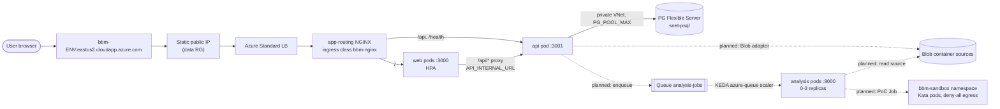
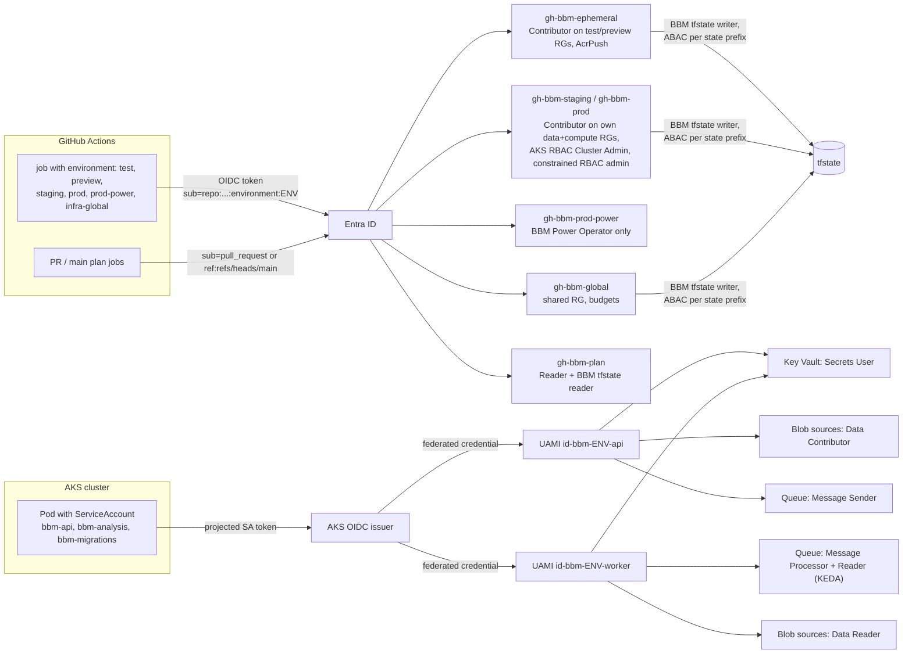
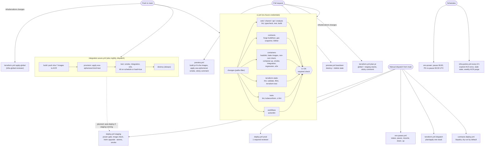

# DevOps architecture

How the marketplace is packaged, tested, deployed and scaled. The decisions and the pinned
interfaces behind this page are in [ADR 0001](../adr/0001-azure-environment-topology.md). The
runbooks are [Azure bootstrap](azure-bootstrap.md) (one-time setup) and
[Environment lifecycle](env-lifecycle.md) (turning staging and prod on and off). Costs are in
[cost.md](cost.md).

## Overview

The system is a small set of containers built from this monorepo. The same images run in four
places:

1. **Docker Compose**, on a laptop and in the `ci.yml` `containers` job.
2. **Azure Container Apps (ACA)** for short-lived environments: one per pipeline-test run and one
   per open pull request.
3. **AKS**, one cluster each for **staging** and **prod**. These are long-lived but can be paused
   or torn down on demand.
4. **Foundry/anvil** for the local chain. The contracts image also deploys to Sepolia through a
   dispatch-only workflow.

All infrastructure is Terraform (`infra/terraform`), the cluster workloads are one Helm chart
(`deploy/helm/bbm`), and GitHub Actions talks to Azure over OIDC only. The required check
`CI OK` never needs cloud credentials.

## Components and containers

| Component        | Source             | Image                | Port | Health       | Notes                                                                                                |
| ---------------- | ------------------ | -------------------- | ---- | ------------ | ---------------------------------------------------------------------------------------------------- |
| web              | `apps/web`         | `bbm/web`            | 3000 | `/healthz`   | Next.js. Proxies `/api/*` to `API_INTERNAL_URL`. A `-mocked` variant is built with MSW enabled.      |
| api              | `apps/api`         | `bbm/api`            | 3001 | `/health`    | Fastify. Postgres via `DATABASE_URL`. Uploads go to `SOURCE_STORAGE_DIR` (local disk for now).       |
| analysis         | `workers/analysis` | `bbm/analysis`       | 8000 | `/health`    | Python (FastAPI). `POST /analyze` is a 501 stub. Slither + LLM explanation are planned.              |
| anvil            | `contracts`        | `bbm/contracts`      | 8545 | JSON-RPC     | Local chain for compose and CI only.                                                                 |
| contracts-deploy | `contracts`        | `bbm/contracts`      | n/a  | n/a          | One-shot `forge script script/Deploy.s.sol`. Writes `deployments/31337.json`.                        |
| postgres         | upstream           | `postgres:16-alpine` | 5432 | `pg_isready` | Compose service, ACA sidecar (`<acr>/mirror/postgres:16-alpine`), or PG Flexible Server on AKS envs. |

- Images are tagged `${BBM_REGISTRY:-bbm}/<svc>:${BBM_TAG:-local}` in compose. In ACR they are
  `acrbbm<sfx>.azurecr.io/bbm/<svc>:sha-<7>` (main), `pr-<n>-sha-<7>` (previews), plus `-mocked`
  for the mocked web build.
- Every image runs as non-root: uid 1000 for web and api, 10001 for analysis. CI checks this.
  The Helm chart adds `runAsNonRoot`, a read-only root filesystem and the `RuntimeDefault` seccomp
  profile.
- Third-party runtime images (Postgres, curl for `helm test`) are mirrored into ACR to avoid
  Docker Hub rate limits.

## Environments

| Environment       | Runtime                                                           | Lifetime                                                   | Data durability                                                            | Who triggers it                                                                      |
| ----------------- | ----------------------------------------------------------------- | ---------------------------------------------------------- | -------------------------------------------------------------------------- | ------------------------------------------------------------------------------------ |
| Local compose     | Docker Compose (`pnpm stack:up`)                                  | until `pnpm stack:down`                                    | named volumes; `stack:down` removes them                                   | a developer                                                                          |
| CI compose        | Compose on a GitHub-hosted runner (`ci.yml` `containers`)         | one job                                                    | none (`down -v` always)                                                    | every push and PR, path-filtered                                                     |
| ACA pipeline test | ACA Consumption, `rg-bbm-test-eus2`, `cae-bbm-run-<id>-<attempt>` | one `integration-azure.yml` run; TTL 6 h as a fallback     | Postgres sidecar, discarded                                                | push to `main`, nightly 07:00 UTC, manual dispatch                                   |
| ACA preview       | ACA Consumption, `rg-bbm-preview-eus2`, `cae-bbm-pr-<n>`          | PR opened → PR closed; TTL 168 h, re-stamped on every push | Postgres sidecar, discarded                                                | `preview.yml` on PR events (same-repo, not docs-only)                                |
| AKS staging       | `aks-bbm-staging-eus2` + data stack                               | long-lived, `running` / `paused` / `down`                  | PG Flexible Server, Blob, Queue, Key Vault: persistent across power states | `deploy.yml` / `env-power.yml` dispatch from `main`, no reviewer                     |
| AKS prod          | `aks-bbm-prod-eus2` + data stack                                  | long-lived, `running` / `paused` / `down`                  | same as staging                                                            | `deploy.yml` / `env-power.yml` from `main`, 1 required reviewer to turn on or change |

Both AKS environments are paused nightly at 06:00 UTC unless their data resource group is tagged
`auto-pause=false`. See [env-lifecycle.md](env-lifecycle.md) for the state machine.

## Azure layers

Four layers, each with its own Terraform stack and state key. Nothing durable lives in `compute`
or in the ephemeral ACA layer, so both can be destroyed without losing data, the ingress IP or the
DNS name.

```mermaid
flowchart TB
    subgraph Global["Global: rg-bbm-shared-eus2 + rg-bbm-tfstate-eus2 (stacks bootstrap, global)"]
        TFS[("tfstate storage<br/>stbbmtfstateSFX, Entra auth only")]
        ACR["ACR acrbbmSFX (Basic)<br/>bbm/web, bbm/api, bbm/analysis, bbm/contracts, mirror/*"]
        LAW["Log Analytics log-bbm-shared-eus2<br/>daily cap 0.25 GB"]
        SKV["Key Vault kv-bbm-shared-SFX<br/>Sepolia RPC, deployer key, Etherscan key"]
        PULL["UAMI id-bbm-aca-pull (AcrPull)"]
        BUD["Budgets: $50 subscription, $20 per env RG"]
        APPS["Entra app registrations gh-bbm-*<br/>(GitHub OIDC)"]
    end

    subgraph Data["Per env data: rg-bbm-ENV-data-eus2 (stack data, persistent)"]
        VNET["VNet vnet-bbm-ENV-eus2<br/>snet-aks /20, snet-psql /24, snet-pe /24"]
        PG[("PG Flexible psql-bbm-ENV-eus2<br/>B1ms, v16, private")]
        KV["Key Vault kv-bbm-stg/prd-SFX<br/>database-url, llm-api-key"]
        ST["Storage stbbm + stg/prd + SFX<br/>blob sources, queue analysis-jobs"]
        PIP["Static PIP pip-bbm-ENV-ingress<br/>bbm-ENV.eastus2.cloudapp.azure.com"]
        UAMI["UAMIs id-bbm-ENV-aks, -api, -worker, -sandbox"]
        ELAW["Log Analytics log-bbm-ENV-eus2"]
    end

    subgraph Compute["Per env compute: rg-bbm-ENV-compute-eus2 (stack compute, disposable)"]
        AKS["AKS aks-bbm-ENV-eus2 (Free tier)<br/>CNI Overlay + Cilium, OIDC issuer, workload identity"]
        POOLS["Node pools: system 1-2, apps 0-3, sandbox 0-1 (Kata, off)"]
        ADDONS["Add-ons: app-routing NGINX, KV Secrets Store CSI, KEDA,<br/>Container Insights (prod only)"]
        FIC["Federated credentials for bbm-api, bbm-analysis,<br/>bbm-migrations, bbm-sandbox-runner, keda-operator"]
        AKS --- POOLS
        AKS --- ADDONS
    end

    subgraph Ephemeral["Ephemeral: rg-bbm-test-eus2 / rg-bbm-preview-eus2 (stack aca-ephemeral)"]
        CAE["ACA env cae-bbm-run-ID or cae-bbm-pr-N<br/>Consumption, tagged expires_on"]
        AAPI["app api + postgres sidecar (1 replica)"]
        AWEB["app web (test 1-2, preview 0-2)"]
        CAE --- AAPI
        CAE --- AWEB
    end

    Compute -- remote state --> Data
    Data -- remote state --> Global
    Compute -- remote state --> Global
    Ephemeral -- remote state --> Global
    AKS -- kubelet AcrPull --> ACR
    PULL -- pulls --> ACR
    CAE -- logs --> LAW
    AKS -- binds --> PIP
    AKS -- nodes in --> VNET
```

## Request path

On AKS the ingress routes `/api` and `/health` straight to the API service and everything else to
web. Web also proxies `/api/*` server-side to `API_INTERNAL_URL`. That proxy is how the browser
reaches the API in compose and on ACA (ACA also gives `api` its own external URL, which the test
suites and k6 use).

Dashed edges are designed and provisioned (identities, roles, queue, container, ScaledObject
template) but not yet wired in application code. `analysis.enabled` and `sandbox.enabled` are
`false` in both env values files.

## Identity

There are no client secrets in GitHub or in the cluster.

- The constrained RBAC Administrator conditions let CI identities assign only an allow-listed set
  of roles, and only to service principals, so a CI token can never grant a human access.
- `id-bbm-<env>-sandbox` deliberately has no role assignments, because it runs untrusted code.
- Key Vault secrets reach pods through the Secrets Store CSI driver: SecretProviderClass `bbm-kv`
  syncs them into the Kubernetes Secret `bbm-secrets`.
- On ACA, images are pulled with `id-bbm-aca-pull`. The Postgres sidecar password is a random
  value generated per environment.

## CI/CD pipeline

- Every Azure workflow starts with a `gate` job that skips green until bootstrap has set the repo
  variables, and never runs Azure steps for fork PRs.
- Today staging is deployed by dispatching `deploy.yml` (or by `env-power.yml up`, which redeploys
  the last tag). An automatic staging deploy after a green `integration-azure.yml` run is not wired
  yet.
- `deploy.yml` and every mutating `env-power.yml` job share the concurrency group `env-<env>`, so a
  deploy never races a pause or resume. `deploy.yml` skips cleanly when the cluster is not running.
- Ephemeral workflows never cancel mid-apply or mid-destroy, because that would strand resources and
  a leased state blob.

### Fast iteration

- `pnpm stack:up` runs the whole stack locally from the same Dockerfiles CI uses.
  `NEXT_PUBLIC_API_MOCKING=enabled pnpm dev` runs the web app with no backend at all.
- `ci.yml` is path-filtered per package, so a docs or single-package change runs only the jobs it
  affects. Docker layers are cached in the GitHub Actions cache per image.
- `infra/terraform/scripts/ci-static.sh` and the `helm lint` / `kubeconform` commands in
  [deploy/helm/README.md](../../deploy/helm/README.md) run the same checks locally as CI.
- Every PR gets a live preview URL in a sticky comment within minutes, with no cluster to manage.
- Test tiers (unit, DB integration, system integration, regression goldens, smoke, e2e, load) use
  the same suites in compose and on Azure, switched by `BBM_*` URLs. See
  [tests/README.md](../../tests/README.md).

## Horizontal scalability and stability under load

**What scales today**

- **Stateless web.** Web holds no state and scales on CPU with an HPA: staging 1–3 replicas, prod
  2–5 with a PodDisruptionBudget (`minAvailable: 1`).
- **Nodes.** The cluster autoscaler is on for every pool. `system` is 1–2 nodes in both envs.
  Prod adds an `apps` pool (1–3 nodes, label `bbm.io/pool=apps`) and keeps system nodes for
  critical add-ons only. Staging runs everything on the system pool to save cost.
- **Ingress.** The app-routing NGINX controller itself scales 1–2 replicas in staging and 2–3 in
  prod.
- **Spreading.** Pods have topology spread constraints on `kubernetes.io/hostname`
  (`ScheduleAnyway`), so replicas land on different nodes when there are several. Spreading across
  availability zones is not configured yet.
- **Disruption.** PDBs are rendered only when the minimum replica count is above 1, so a
  single-replica environment can still drain nodes during upgrades.
- **Queue-driven workers.** The analysis worker has a KEDA `azure-queue` ScaledObject on
  `analysis-jobs` (0–3 replicas, 5 messages per replica, 300 s cooldown), so it scales to zero when
  idle. It is disabled until the worker does real work.

**Database**

- PG Flexible `B_Standard_B1ms` allows roughly 50 connections. The API's pool defaults to
  `PG_POOL_MAX=5` per pod, which leaves room for the migrations Job, the worker and admin sessions
  as API replicas grow. The chart's `api.pgPoolMax` defaults to the same 5.
- Migrations run once per release as a Helm pre-install/pre-upgrade Job
  (`node dist/migrate-cli.js`, SA `bbm-migrations`) with `MIGRATE_ON_BOOT=false` in the Deployment.
  The migrator also takes a Postgres advisory lock, so even concurrent runners serialise instead of
  racing.
- B1ms is burstable. Under sustained load it runs on CPU credits; once those are gone it drops to
  baseline. Moving to a General Purpose SKU is a tfvars change in `envs/<env>/data.tfvars`.

**Known limit: one API replica**

The API writes uploaded sources to a per-pod `emptyDir` (`SOURCE_STORAGE_DIR`). Two replicas
would split uploads between pods, so `api.hpa.maxReplicas` is 1 in both envs. The rollout strategy
is `maxSurge: 0`, which means a short gap during each API deploy. The Blob `sources` container, the
api identity's Blob Data Contributor role and the `storageBlobEndpoint` value already exist. Once a
Blob storage adapter replaces local disk, the API becomes stateless and its HPA max can be raised.
Uploaded files on the `emptyDir` are also lost when a paused cluster resumes, because nodes are
recreated.

**Load testing**

- `tests/load/api-baseline.js` (k6 `grafana/k6:2.3.0`) ramps to 20 VUs for a minute against
  `GET /health` and `GET /api/contracts/:id`. Thresholds: p95 under 500 ms and errors under 1%. k6
  fails the run if either is breached.
- `SOAK=1` adds a 10-minute constant 10-VU soak scenario for the "sustained load" goal.
- `integration-azure.yml` runs k6 nightly and when dispatched with `load: true`, against the ACA
  test env. It never targets prod, because `setup()` writes a row.
- The ACA test env is 0.25 vCPU per container with Postgres as a sidecar, so its numbers are a
  regression baseline, not a capacity figure. Capacity runs belong on staging with
  `auto-pause=false`.

**Isolation for untrusted code**

- Auditor PoCs will run as Jobs in the `bbm-sandbox` namespace on a dedicated `sandbox` pool with
  Kata VM isolation (`runtimeClassName: kata-vm-isolation`), a taint, a deny-all NetworkPolicy, a
  ResourceQuota, a 600 s deadline and an identity with no Azure roles.
- The pool and the Job template are off by default. Kata needs a nested-virtualisation size (Dsv5)
  and quota a new subscription may not have.
- The `bbm` namespace is default-deny for ingress (only the ingress controller, web → api and
  `helm test` are allowed). With `networkPolicy.restrictEgress`, which is on in staging and prod,
  egress is default-deny too: DNS for everyone, web → api only, api and migrations → Postgres on
  `snet-psql`, and api/analysis → HTTPS 443 (Entra, Storage).

## Known gaps and next steps

- **Blob storage adapter** for uploads. This removes the API single-replica limit (see above).
- **Wire the queue.** The API should enqueue analysis jobs and the worker should consume them.
  Then enable `analysis` and the KEDA ScaledObject in the env values.
- **TLS.** Ingress is plain HTTP (`tls.mode: none`). cert-manager or Key Vault certificates are
  the next step.
- **Zone spreading** for prod pods and a zone-redundant node pool layout.
- **Automatic staging deploy** from `main` after `integration-azure.yml` passes.
- **Sandbox pool** once Dsv5 quota is granted.
- **Observability.** Container Insights is on in prod only. There are no alert rules on error
  rate, latency or PG connections yet.
- **Database HA.** PG is a single zonal server without HA or geo-redundant backup (7-day backup
  retention). That's fine for demos, not for real funds.
