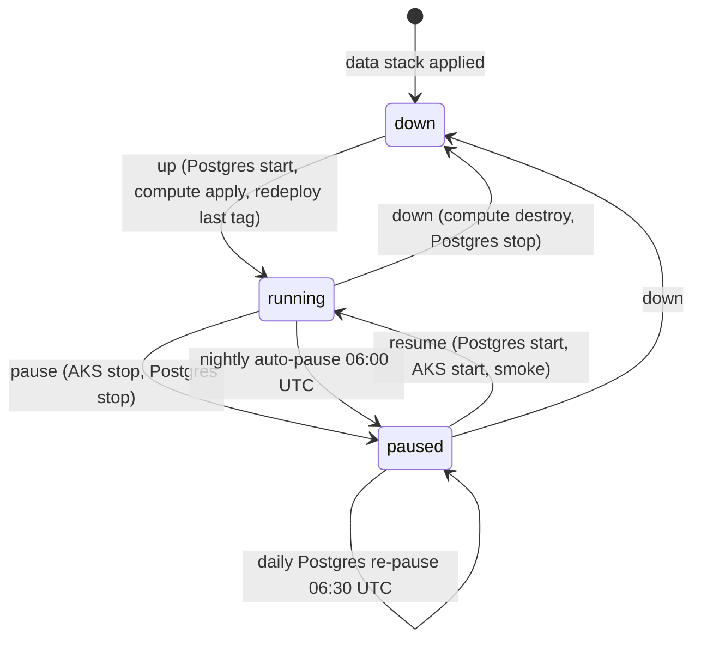

# Environment lifecycle: turning staging and prod on and off

Staging and prod each run on their own AKS cluster. They only need to be up for testing,
development and demos, so both can be switched off on demand without losing data. The design is
in [ADR 0001](../adr/0001-azure-environment-topology.md). This page is the runbook.

Everything goes through one workflow, **Env power** (`.github/workflows/env-power.yml`). Its logic
lives in `infra/terraform/scripts/env-power.sh`, which you can also run locally after `az login`.

## States



The current state is stored as tags on the data resource group `rg-bbm-<env>-data-eus2`.
Terraform ignores these tags.

| tag                                                          | values                      | written by                                              |
| ------------------------------------------------------------ | --------------------------- | ------------------------------------------------------- |
| `power-state`                                                | `running`, `paused`, `down` | env-power (`pause`, `resume`, `down`, `up`)             |
| `auto-pause`                                                 | `true` (default), `false`   | you (opt out of the nightly pause)                      |
| `db-paused`                                                  | `true`, `false`             | env-power (`false` when paused with `include_db=false`) |
| `bbm-last-deployed-tag`                                      | `sha-<7>`                   | `deploy.yml` after a successful deploy                  |
| `paused-at`, `resumed-at`, `down-at`, `up-at`, `deployed-at` | UTC timestamps              | env-power / deploy                                      |

`status` reads the real Azure state (AKS power and provisioning state, node pools, Postgres
state), these tags, the ingress FQDN and `GET /health`.

## Actions

| action   | what it does                                                                                 | keeps                                                                               | removes / stops                                                                    | typical time                |
| -------- | -------------------------------------------------------------------------------------------- | ----------------------------------------------------------------------------------- | ---------------------------------------------------------------------------------- | --------------------------- |
| `status` | read-only snapshot                                                                           | everything                                                                          | nothing                                                                            | < 1 min                     |
| `pause`  | `az aks stop`, then `az postgres flexible-server stop` (unless `include_db=false`)           | every resource, cluster config, the IP, all data                                    | node VMs, Postgres compute                                                         | 2–5 min                     |
| `resume` | Postgres start (waits for Ready), `az aks start`, waits for `/health`, read-only smoke tests | everything                                                                          | nothing                                                                            | 5–15 min                    |
| `down`   | `terraform destroy` of the **compute** stack, then Postgres stop. Needs `confirm=<env>`      | Postgres + data, Key Vault, storage, identities, static IP and DNS name, ACR images | AKS cluster, node pools, node RG contents, workload-identity federated credentials | 5–10 min                    |
| `up`     | Postgres start, `terraform apply` of compute, then `deploy.yml` with the last deployed tag   | n/a                                                                                 | n/a                                                                                | 10–15 min + deploy (~5 min) |

The data stack is never touched by env-power. Your database, uploaded sources and secrets survive
every action.

### What it costs

Rough eastus2 list prices (check the Azure pricing calculator for current numbers):

| state     | still billed                                                                                                               | roughly           |
| --------- | -------------------------------------------------------------------------------------------------------------------------- | ----------------- |
| `running` | nodes (B2als_v2: staging 1, prod 2+), Postgres B1ms compute, plus everything below                                         | ~$1–3 per day     |
| `paused`  | Postgres storage, the static public IP, the AKS load balancer and its frontend IP, managed disks, Key Vault, storage, logs | ~$0.20–0.50 / day |
| `down`    | Postgres storage, the static public IP, Key Vault, storage, logs                                                           | ~$0.15–0.30 / day |

AKS is on the Free tier, so a stopped cluster has no control-plane charge. Choose `pause` for
"off until tomorrow" and `down` for "off for a week or more".

## Approvals

| action                     | staging                         | prod                                                 |
| -------------------------- | ------------------------------- | ---------------------------------------------------- |
| `status`                   | none (plan identity, read-only) | none (plan identity, read-only)                      |
| `pause`                    | none (`staging`)                | none: `prod-power` environment, power-only identity  |
| `resume`                   | none (`staging`)                | 1 reviewer (`prod`)                                  |
| `down`                     | none (`staging`), `confirm`     | 1 reviewer (`prod`), `confirm=prod`                  |
| `up`                       | none (`staging`)                | 1 reviewer for `up`, then again for the redeploy job |
| scheduled pause / re-pause | none (`staging`)                | none (`prod-power`)                                  |

Anyone with workflow access can turn prod **off**. Turning it **on**, or changing it, needs a
reviewer. `gh-bbm-prod-power` can only read, start and stop AKS and Postgres and write tags. It has
no Terraform state access and no Contributor role.

All environments only accept runs from `main`. `status` uses the plan identity, which is federated
for `ref:refs/heads/main`, so dispatch it from `main` too.

`deploy.yml` and every mutating env-power job share the concurrency group `env-<env>`. A deploy
waits for a pause or resume to finish and the other way round. GitHub keeps at most one pending
run per group, so a newer queued run replaces an older queued one.

## Schedules

All times are UTC and run from the default branch.

| cron         | job                    | what it does                                                                                                          |
| ------------ | ---------------------- | --------------------------------------------------------------------------------------------------------------------- |
| `0 6 * * *`  | `scheduled-pause`      | pauses every env whose cluster is running, unless its data RG has `auto-pause=false`                                  |
| `30 6 * * *` | `scheduled-repause-db` | Azure auto-starts a stopped Postgres after 7 days. If the env is `paused`/`down` and Postgres is Ready, stop it again |
| `0 11 * * 0` | `scheduled-pause`      | Sunday retry: the AKS maintenance window (Sun 06:00–10:00) can block the 06:00 stop                                   |

### Opting out of the nightly pause

For a multi-day demo or a long load test:

```sh
az group update -n rg-bbm-<env>-data-eus2 --set tags.auto-pause=false
# and afterwards
az group update -n rg-bbm-<env>-data-eus2 --set tags.auto-pause=true
```

Remember to turn it back on. An opted-out environment runs (and bills) until someone pauses it.

## Demo-day checklist

1. **The day before:** run **Env power** with `action=resume` (paused) or `action=up` (down). For
   prod, a reviewer must approve.
2. If the demo spans 06:00 UTC, set `auto-pause=false` (see above).
3. Run `action=status`. Check: AKS `Running`/`Succeeded`, Postgres `Ready`, `/health` `ok`.
4. Check the smoke result in the resume/deploy run summary. To redeploy a specific build, run
   **Deploy (AKS)** with `image_tag=sha-<7>`.
5. Share the URL: `http://bbm-<env>.eastus2.cloudapp.azure.com` (http until TLS is enabled in
   `values-<env>.yaml`).
6. **After the demo:** run `action=pause` and set `auto-pause=true` again if you changed it.

## Running it locally

```sh
az login
infra/terraform/scripts/env-power.sh staging status
infra/terraform/scripts/env-power.sh staging pause --include-db true
infra/terraform/scripts/env-power.sh staging resume
```

`down` and `up` need Terraform and state access, so run them through the workflow.

## Limitations

- **Load balancer and public IP are billed while paused.** The static IP lives in the data RG on
  purpose, so the DNS name survives `down`.
- **Postgres auto-starts after 7 days stopped.** The 06:30 job stops it again. Between the
  auto-start and that job you pay for up to a day of Postgres compute.
- **A stop is refused unless `provisioningState` is `Succeeded`.** Upgrades and node image updates
  run in the Sunday 06:00–10:00 UTC maintenance window. A scheduled pause that hits it exits with a
  warning, and the 11:00 Sunday run retries. A manual pause exits with code 3; retry later.
- **A cluster can stay stopped for at most 12 months.** After that AKS may no longer start it.
  Auto-upgrades also only happen while the cluster runs, so a long-paused cluster falls behind on
  patches. Prefer `down`/`up` for long breaks: `up` creates a fresh cluster on the current patch.
- **`up` gives the cluster a new OIDC issuer.** The compute stack recreates the federated
  credentials, so a full `up` must finish before you deploy. The workflow's `redeploy` job does that.
- **`down` is refused without `confirm=<env>`**, and the run still needs the prod reviewer for prod.

## Troubleshooting

| symptom                                                       | cause / fix                                                                                                                                                                                                                                      |
| ------------------------------------------------------------- | ------------------------------------------------------------------------------------------------------------------------------------------------------------------------------------------------------------------------------------------------ |
| Deploy run is green but says "skipped: env is paused/down"    | Expected. Run `resume` (or `up`), then deploy again. `up` redeploys automatically.                                                                                                                                                               |
| `refusing to stop ...: provisioningState is 'Upgrading'`      | Maintenance or another operation is running. Wait: `az aks show -g rg-bbm-<env>-compute-eus2 -n aks-bbm-<env>-eus2 --query provisioningState`.                                                                                                   |
| `cluster ... not found: <env> is down`                        | The compute stack was destroyed. Use `up`, not `resume`.                                                                                                                                                                                         |
| Resume finished but `/health` never answers                   | Pods are still starting or crash-looping. `kubectl -n bbm get pods`, `kubectl -n bbm describe pod ...`. Check Postgres is `Ready`. A failing Key Vault CSI mount usually means a broken federated credential: run `up`, which reapplies compute. |
| `Postgres ... is 'Updating'; cannot stop it now`              | Azure maintenance on the server. Retry later.                                                                                                                                                                                                    |
| Deploy: `No image_tag given and ... no bbm-last-deployed-tag` | First deploy to this env. Pass `image_tag=sha-<7>` (an image built by CI on `main`).                                                                                                                                                             |
| Deploy: `missing image <acr>/bbm/api:sha-...`                 | That tag was never pushed, or the janitor purged it. Build it or pick another tag. Also `mirror/curl:8.10.1` must be imported once per ACR (see `deploy/helm/README.md`).                                                                        |
| A scheduled run fails with an OIDC / `AADSTS700213` error     | The GitHub Environment (`staging` / `prod-power`) or its `AZURE_CLIENT_ID` variable is missing. Re-run the bootstrap `gh_setup_commands`.                                                                                                        |
| Tags look wrong (`power-state=running` but cluster stopped)   | Someone used the portal or CLI directly. Run `pause` or `resume` once; both are idempotent and rewrite the tags.                                                                                                                                 |
